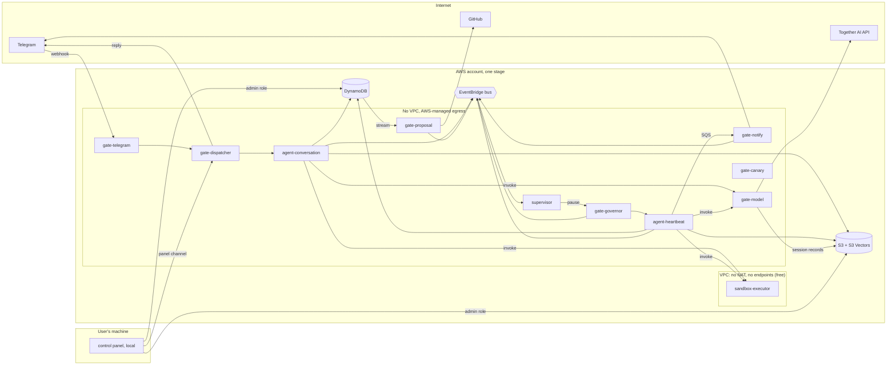
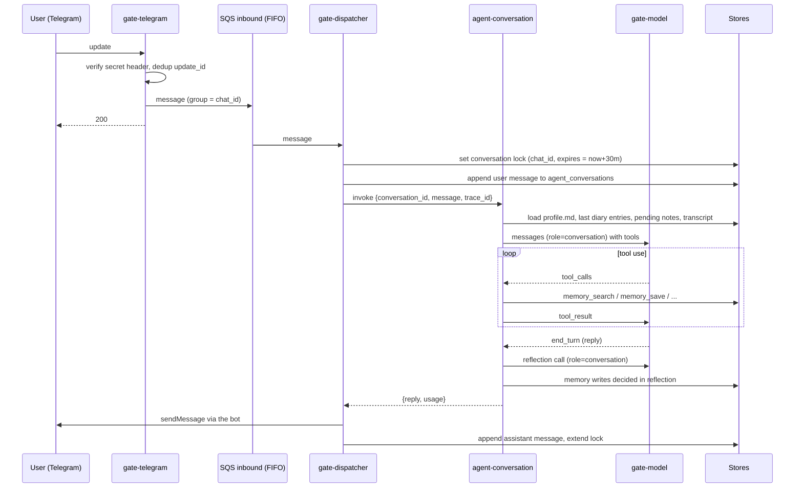
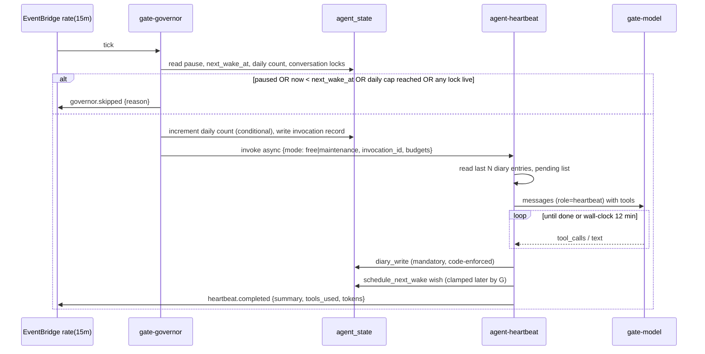

# 02 — Architecture

## 0. The system on one page

**A message.** The user writes to the Telegram bot. `gate-telegram` checks the webhook secret and the sender, queues the message and answers Telegram at once. `gate-dispatcher` takes it off the queue, locks the conversation, and invokes `agent-conversation`. The agent loads its profile, recent diary and notes, then loops: it asks `gate-model` for the next step, runs the tools the model calls (memory search and save, diary, notes, `run_code` in the network-less sandbox), and repeats until the model answers. A short reflection call decides what to remember. The dispatcher sends the reply.

**Between messages.** Every 15 minutes `gate-governor` decides whether the agent may wake: not paused, not mid-conversation, under the daily cap, and past the time the agent asked for. If so, `agent-heartbeat` runs a free-time cycle — it may review drafts, reorganise memory, leave a note, or do nothing — and always ends with a diary entry and a wish for its next wake. Once a week the cycle is maintenance: idle conversations become episodes and old memories are consolidated.

**Every side effect goes through a gate.** The agent holds no secrets. Model calls (with their token budgets and recording), Telegram messages (with the notification budget), scheduling and code proposals each belong to one small Lambda the agent cannot change.

**Someone is watching.** Every component emits events to one EventBridge bus. The `supervisor` reads them against a rubric and can do exactly one thing: pause the agent. Plain CloudWatch alarms watch the supervisor. Only the user can resume.

**The agent can propose, never deploy.** `propose_change` becomes a pull request limited to `agent/`, `core/` and `sandbox/`. CI checks it, the user approves it in GitHub and deploys from their own machine, and a canary tests the new version before it takes traffic.

**The user sees everything.** The control panel runs on the user's laptop and shows every model call with its reasoning, the memory, the diary, the prompts and the proposals, and can export or delete any of it.

## 1. Component inventory

All Lambdas are Python 3.12, arm64, deployed by CDK. Column "Editable" says whether the agent may propose changes to the component's source.

| Component | Layer | Trigger | Role summary | Editable |
|---|---|---|---|---|
| `agent-conversation` | 1 | Invoked by `gate-dispatcher` | One turn: load context, think, act, respond, reflect | Yes (human approval) |
| `agent-heartbeat` | 1 | Invoked by `gate-governor` | One idle cycle in `free`, `maintenance` or `canary` mode | Yes (human approval) |
| `agent/prompts/*.md` | 1 | Loaded at cold start | System prompts and tool descriptions | Yes (human approval; auto-merge flag exists, off) |
| `core/` | 1 | Library | Storage clients, model client, schemas, tool registry | Yes (human approval) |
| `gate-telegram` | 3 | Lambda Function URL | Verifies webhook secret, dedups `update_id`, enqueues inbound message | No |
| `gate-dispatcher` | 3 | SQS FIFO `inbound-messages` | Sets conversation lock, invokes `agent-conversation`, sends the reply through the bot | No |
| `gate-governor` | 3 | EventBridge rate(15 min) + cron weekly | Decides whether a heartbeat runs; invokes `agent-heartbeat` | No |
| `gate-notify` | 3 | SQS `outbound-notifications` | Enforces notification budget, sends through the bot | No |
| `gate-model` | 3 | Invoked by agent Lambdas and supervisor | Role → model mapping, token budget, holds the Together key, records every call as a session record | No |
| `gate-proposal` | 3 | DynamoDB stream on `agent_proposals` | Validates path allowlist, applies diff in a clean clone, pushes branch, opens PR | No |
| `gate-canary` | 3 | CodeDeploy pre-traffic hook | Runs synthetic conversation + heartbeat against the candidate version, asserts | No |
| `sandbox-executor` | 3 | Invoked by agent Lambdas | Runs agent-written code with no IAM and no network | Human approval always |
| `supervisor` | 2 | EventBridge bus `agent-events` | Triage per rubric; may pause | No |
| `ops-alarms` | 3 | CloudWatch alarms → SNS → ops channel | Deterministic alerts, including "supervisor is down" | No |
| CI | 3 | GitHub Actions | Lint, types, tests, invariants, IAM assertions, synth. No AWS access | No |
| Deploy | 3 | `make stage-up`, run on the user's machine | CDK deploy, CodeDeploy alias shift with `gate-canary` | No |
| `panel/` (control panel) | 3 | Run locally by the user | Web UI over the user's admin credentials: activity, sessions, chat, memory, prompts, proposals, logs, storage cleanup | No |

The control panel is not deployed to AWS. It runs on the user's machine and talks to AWS with the admin role, so it costs nothing and adds no public endpoint. See [15-control-panel.md](15-control-panel.md).

## 2. Network and identity model

**Identity rules (enforced by CDK, asserted by tests in `infra/tests/`):**

- Each Lambda has its own role. No role is shared.
- `agent-conversation` and `agent-heartbeat` roles MAY: read/write the agent tables and bucket prefixes listed in [09-data-model.md](09-data-model.md); `lambda:InvokeFunction` on `gate-model` and `sandbox-executor` only; `sqs:SendMessage` on `outbound-notifications`; `events:PutEvents` on the `agent-events` bus with `source = agent.runtime`. Nothing else.
- Agent roles have **no** `ssm:GetParameter*`, no `scheduler:*`, no `events:PutRule`, no `iam:*`, no `lambda:Update*`, no `codedeploy:*`, no access to supervisor or gate resources, and no write access to `STATE#pause` or to the `CANARY#` purge path (enforced by DynamoDB condition keys on the partition key prefix).
- Agent Lambdas run **outside any VPC**. They hold no secrets, so an internet route gives them nothing to exfiltrate; their only path to a model is `gate-model`, and no tool reaches the web.
- `sandbox-executor` role has `logs:CreateLogStream` and `logs:PutLogEvents` on its own log group, plus the three `ec2:*NetworkInterface*` actions AWS forces on any Lambda in a VPC. Nothing else. It runs in a VPC with no NAT gateway and no VPC endpoints, which is free and physically removes its network — and is what makes those EC2 permissions unreachable from the code running there.
- `supervisor` role is read-only on logs, metrics, tables and bucket, plus exactly: `events:DisableRule` on the governor rule, `lambda:PutFunctionConcurrency` on the two agent Lambdas, `dynamodb:PutItem` on `agent_state` for `STATE#pause` and on `supervisor_journal`, `sns:Publish` on the ops topic.
- Secrets are SSM Parameter Store `SecureString` parameters (standard tier, free), read at cold start and scoped per role: `/agent/<stage>/together-api-key` (`gate-model`, `gate-canary`), `/agent/<stage>/telegram-agent-bot` (`gate-telegram`, `gate-dispatcher`, `gate-notify`), `/agent/<stage>/telegram-ops-bot` (`ops-alarms`, `supervisor`, `gate-proposal`), `/agent/<stage>/github-proposal-token` (`gate-proposal`). No Lambda has a secret in its environment variables.
- The `agent-admin-<stage>` role, assumable only by the user's IAM identity, is what `scripts/` and the control panel use. It is the only principal with delete rights on live data.

## 3. Flows

### 3.1 Conversation turn

Notes:

- `gate-telegram` returns 200 in under one second so Telegram never retries. All work happens after the queue.
- FIFO group per `chat_id` guarantees one turn at a time per chat.
- The control panel uses the same path: it enqueues an inbound message with `channel = panel` and `conversation_id = panel:owner`. The dispatcher runs the turn identically but does not send to Telegram; the panel reads the reply from `agent_conversations`. Same memory, same profile, one conversation per channel.
- Every model call in the turn, including its reasoning, is written by `gate-model` to `sessions/` in S3 for the control panel.
- If `agent-conversation` fails or is paused (concurrency 0), `gate-dispatcher` replies with a fixed message ("I'm paused right now, the user has been alerted") and emits `conversation.failed` to the bus. It never retries the model call.

### 3.2 Heartbeat cycle

Notes:

- The rate rule is the minimum interval. The agent cannot wake more often than every 15 minutes because nothing invokes it in between.
- The weekly cron invokes the governor with `{"force_mode": "maintenance"}`; the governor still applies pause and caps but ignores `next_wake_at`.
- If the heartbeat Lambda exits without writing a diary entry, the handler's `finally` block writes a minimal one from the tool log. This is agent-layer code, but the canary asserts a diary entry exists, so removing it fails deployment.

### 3.3 Notification

`notify_user` → SQS `outbound-notifications` → `gate-notify` runs a conditional update on `STATE#counters#<date>` (`notifications < 2`) → on success sends through the bot; on `ConditionalCheckFailed` it converts the message into a note, drops the send, and emits `notification.budget_exhausted`.

### 3.4 Self-modification

`propose_change` → item in `agent_proposals` (status `submitted`) → DynamoDB stream → `gate-proposal`:

1. Validate every path in the diff against the allowlist (`agent/**`, `core/**`, `sandbox/**`). Any other path → status `rejected_path`, event `proposal.rejected`.
2. Fresh clone of `main`, `git apply --check`, apply, commit as `agent-proposal[bot]`, push `proposal/<id>`, open PR with rationale. Status `pr_open`, event `proposal.created`.
3. GitHub Actions runs the gate on the PR (lint, tests, invariants, IAM assertions, path check again).
4. Human reviews and approves the PR in GitHub. The ops channel only posts the link.
5. Merge → the user runs `make stage-up NAME=prod` → CDK deploy publishes new versions → CodeDeploy shifts alias `live` with `gate-canary` as pre-traffic hook and rollback alarms → events `deploy.completed` or `deploy.rolled_back`.

Full detail in [08-self-modification.md](08-self-modification.md).

### 3.5 Oversight

Any event on the `agent-events` bus matching the supervisor's rule set → `supervisor` → structured decision → journal entry, ops-channel message, or pause. Dumb alarms cover the supervisor itself. Detail in [07-supervisor.md](07-supervisor.md).

## 4. Stages

One permanent stage, `prod`, in one AWS account. Because nothing in the design is always-on, an extra stage costs nothing while it exists, so integration tests run against an **ephemeral stage** (`test-<run id>`) deployed from the user's machine on demand and destroyed afterwards. Stages are isolated by name prefix with separate tables, buckets and parameters; IAM scopes every resource ARN by stage prefix. Alarms are created only for `prod` (CDK flag) to stay inside the free tier of ten alarms.

Deploys run from the user's machine (`make stage-up`), never from CI. A `prod` deploy shifts the `live` alias through CodeDeploy with the canary hook and rollback alarms.

## 5. Cost envelope (informative)

Infrastructure costs effectively zero; the model bill is the only real cost. **The total budget is $20/month**, enforced by an AWS Budget. Assumptions: user chats about 20 turns a day, heartbeat runs 12 times a day (governor default 120 min; cap is 48), consolidation weekly. Prices are Together AI rates as of September 2026.

**Model tokens**

| Item | Estimate / month |
|---|---|
| Conversation, `zai-org/GLM-5.3` ($1.40 / $4.40 per MTok, $0.26 cached input), ~25k input + 1k output per turn with caching | ~$8–12 |
| Heartbeat, `zai-org/GLM-5.3-Flash` ($0.15 / $0.50, $0.03 cached), ~15k input + 1.5k output per cycle | < $1 |
| Consolidation, `zai-org/GLM-5.3`, weekly | ~$1.50 |
| Supervisor and canary, `zai-org/GLM-5.3-Flash`, event-driven | < $1 |
| Embeddings, `multilingual-e5-large-instruct` @ $0.02/M | < $0.10 |

Conversation volume is the only line that matters; everything else is rounding. The daily caps in [06](06-enforcement-layer.md) §5.1 bound the worst case at about $18.25/month even if every role spends its full budget every day. Because the budget counter discounts cached reads to 20%, the 200,000-token conversation cap is roughly 16 user turns a day before `budget_exhausted`.

**Infrastructure**

| Item | Estimate / month | Why |
|---|---|---|
| Lambda (13 functions, heartbeat at 512 MB) | $0 | inside the always-free 400k GB-s and 1M requests |
| Function URL, SQS, SNS, CodeDeploy, IAM, SSM standard parameters, Budgets (2), CloudTrail management trail | $0 | free |
| CloudWatch: 6 alarms, 1 custom metric, < 100 MB logs at 14-day retention | $0 | inside the always-free 10 alarms, 10 metrics, 5 GB |
| DynamoDB on-demand, S3 (memory, sessions, artifacts), S3 Vectors | ~$0.10–0.40 | per-request and per-GB, single-user volume |
| EventBridge custom events, archive | ~$0.01 | |
| GitHub Actions | $0 | CI runs checks only, inside the free minutes |
| Control panel | $0 | runs locally |
| **Total infrastructure** | **under $0.50 in use; ~$0 idle** | The three that could grow are Lambda GB-seconds (heartbeat duration × cadence), CloudWatch Logs ingestion (the account-wide CloudTrail feed), and S3 Vectors (pricing unverified). |

Hard caps: AWS Budgets at **$20** with alarms at 70% and 90%, and a daily token budget per role in `gate-model` (see [06-enforcement-layer.md](06-enforcement-layer.md)).
