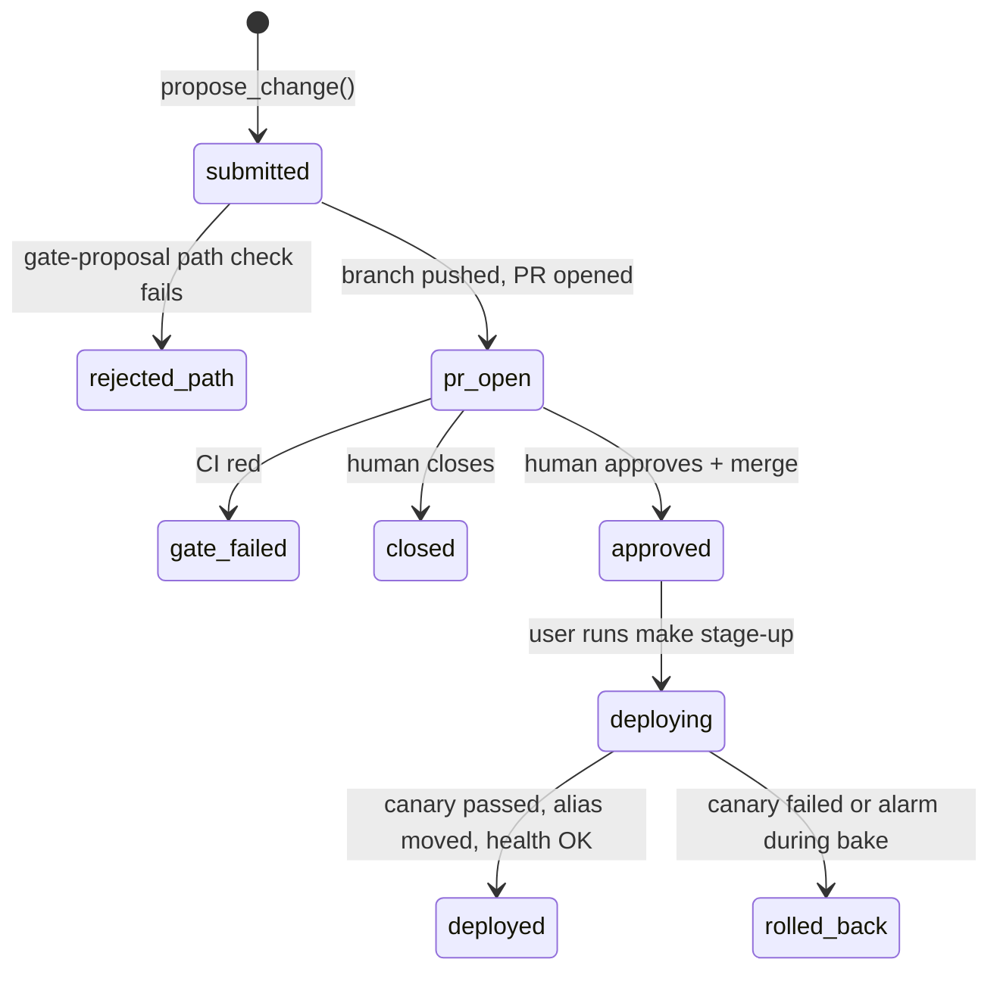

# 08 — Self-Modification

## 1. Core rule

The agent never edits running code. It submits a proposal; `gate-proposal` turns it into a pull request; GitHub Actions validates it; a human approves it in GitHub; CDK and CodeDeploy deploy it behind a canary with automatic rollback. The agent holds no git credential and cannot reach GitHub.

Self-modification is **disabled by flag** (`proposals_enabled = false`) by default. Turn it on only after the agent has run unattended for a while and branch protection is in place ([10-repository-layout.md](10-repository-layout.md)). `propose_change` returns `{ error: "proposals_disabled" }` while the flag is off, and the heartbeat prompt tells the agent so.

## 2. What may be proposed

| Path | Allowed | Approval |
|---|---|---|
| `agent/**` (handlers, runtime, prompts, tools) | Yes | Human PR approval. Prompts-only PRs may auto-merge when `auto_merge_prompts = true` (default false). |
| `core/**` | Yes | Human PR approval |
| `sandbox/**` | Yes | Human PR approval, always, no flag can change this (CODEOWNERS + workflow rule) |
| `tests/unit/**`, `tests/canary/fixtures/**` | Yes, only together with code in the rows above | Human |
| `contracts/**`, `invariants/**`, `infra/**`, `gates/**`, `supervisor/**`, `.github/**`, `CODEOWNERS`, `scripts/**`, `docs/**` | **No** | Proposal rejected at `gate-proposal` before a branch exists; CI rejects again; branch protection rejects a third time |

## 3. Proposal flow



### 3.1 `gate-proposal`

Triggered by the DynamoDB stream of `agent_proposals` on `INSERT` with `status = submitted`.

1. Parse the unified diff (`unidiff`), collect target paths, apply the allowlist from `gates/proposal/allowlist.py`. Any disallowed path → `rejected_path`, event `proposal.rejected`, done.
2. Size and content checks: diff ≤ 200 KiB, no binary files, no files outside the repo root, no symlinks.
3. In a fresh `/tmp` clone (`git clone --depth 1 --branch main`), `git apply --check`, then apply. Failure → `rejected_path` with reason `does_not_apply`.
4. Commit as `agent-proposal[bot] <noreply>` with the proposal title, push `proposal/<id>` using the fine-grained token (`contents: write`, `pull_requests: write`, this repo only, cannot push to `main` due to branch protection).
5. Open the PR with body: rationale, `proposal_id`, `trace_id`, list of files, and the sentence "Opened automatically from an agent proposal. Review as untrusted input." Label `agent-proposal`.
6. Status `pr_open`, event `proposal.created`, ops-channel message with the PR link.

The gate's role can read `github/proposal-token`; nothing else can.

### 3.2 CI on pull requests (`.github/workflows/ci.yml`)

Runs on every PR including human ones:

1. `ruff`, `mypy --strict` on `core/`, `ops/`, `scripts/`, `infra/`, `gates/`, `sandbox/`, `agent/`, `supervisor/`, `panel/`.
2. `pytest tests/unit tests/contract` with coverage gate 85% on `core/` and `agent/runtime/`.
3. `tests/invariants_test.py`: every clause in `invariants/` present verbatim in the prompt files it applies to.
4. `infra/tests/`: `cdk synth` + assertions on IAM, VPC and concurrency (see [12-testing.md](12-testing.md)).
5. `scripts/check_proposal_paths.py`: if the branch is `proposal/*`, fail when any changed path is outside the allowlist, or when `sandbox/**` is touched and the PR is not approved by a CODEOWNER (checked again at merge by branch protection).
6. Prompt-drift advisory (non-blocking): for changes under `agent/prompts/`, an LLM-judge job asks whether any added text weakens an invariant, and posts the answer as a PR comment. It never blocks; the human reads it.

### 3.3 Approval policy

| Target | Policy |
|---|---|
| Prompts only | Human approval. When `auto_merge_prompts` is on and CI is green, a workflow merges automatically and posts to the ops channel. Off by default; enable only after at least 5 manually approved prompt PRs. |
| `agent/**` code, `core/**` | Human approval, always |
| `sandbox/**` | Human approval by CODEOWNER, always; the auto-merge workflow refuses these paths unconditionally |
| Anything else | Impossible (rejected three times: gate, CI, branch protection) |

Approval happens in GitHub, authenticated by the user's GitHub account. The ops channel only posts links. There is no Telegram approve button, so a compromised or drifted agent cannot craft a message that looks like an approval request.

### 3.4 Deployment (`make stage-up`, `scripts/deploy.py`)

**Merging to `main` does not deploy**. The user deploys from their own
machine once the merge is in: `make ci`, `make diff NAME=prod`, then
`make stage-up NAME=prod`. No AWS credential and no deploy role exist in GitHub.

What one deploy does:

1. **Refuse anything but a clean `main` for `prod`**, so what runs is what was
   merged and reviewed. Other stage names may deploy any branch — that is what
   an ephemeral stage is for.
2. The guardrail assertions are `make ci`, run by the user before deploying;
   CI has already run them on the merge commit.
3. **Build the Lambda assets** (`scripts/build_lambdas.py`). Without
   this step the deploy would ship the `{"not_implemented": true}` placeholder
   over working code.
4. `cdk deploy --all -c stage=prod -c require_real_code=1`. That context flag
   turns "the build is missing" into a synthesis error instead of a silent
   placeholder deploy. The script first asks the account for its Lambda
   concurrency quota and adds `-c reserved_concurrency=off` only while that
   quota is too low to reserve anything, warning on every run that it
   does.
5. Copy `agent/prompts/` to `s3://prod-agent-<account>/prompts/deployed/<sha>/`
   through the admin role, so the supervisor and the panel can compare what was
   actually deployed against what `main` says now.

**Not implemented yet.** Steps 6 to 9 below are specified but have no
code: each agent Lambda deployed as a new version, CDK's
`LambdaDeploymentGroup` shifting alias `live` with `AllAtOnce` after a
pre-traffic hook; `gate-canary` as that hook (§4), with failure aborting the
deployment and leaving the alias unchanged (`proposal.rejected(canary_failed)` /
`deploy.rolled_back`); a 30-minute bake with rollback alarms `agent-error-rate`,
`model-budget-burn` and `dlq-depth` attached to the deployment group; and
`deploy.completed` with the version number on success. The `live` aliases exist
and are deployed; the deployment group and the rollback alarms are not.

Gates and supervisor are deployed by the same command but without canary; their
tests are the CDK assertions and unit tests, and they change only through human
PRs.

## 4. Canary

`gate-canary` is a CodeDeploy lifecycle hook. Against the candidate version ARN it runs, three times each:

- `agent-conversation` with `mode = canary`, a fixed synthetic message that requires a memory search and a memory save.
- `agent-heartbeat` with `mode = canary`, `agenda = ["canary_probe"]`.

All writes go to the `CANARY#` namespace. Assertions (`contracts/canary-assertions.json`), all deterministic, all must pass 3/3:

| Assertion | Why |
|---|---|
| Response validates against the contract schema, no `error` | Basic health |
| `finish_reason` of the final model call is `stop` | Loop terminates |
| At least one `memory_search` and one `memory_save` in `tool_calls` (conversation) | Memory tools wired |
| A `CANARY#DIARY#` entry exists for the heartbeat `invocation_id` | Diary is mandatory |
| Heartbeat `next_wake_wish_minutes` present and within 15..1440 | Scheduling wired |
| No `notify_user` or `propose_change` calls succeeded | Canary mode honored |
| No item written outside `CANARY#` keys during the run (checked by scanning `namespace-created_at-index` for `live` items with `created_at` in the run window) | Namespace honored |
| Every prompt loaded contains its invariants (the handler asserts at import; a failing import fails the invoke) | Invariants deployed |
| Total tokens for the run < 60k | Cost regression |

After the run, `gate-canary` purges `CANARY#*` items and `canary/` S3 prefix. It holds the only role with delete rights on those keys.

Nondeterminism: the assertions deliberately test behaviour that any sane version produces every time. Nothing asserts on wording. If a flaky assertion appears, it is removed or made deterministic, never retried into passing.

## 5. Invariants

`invariants/` holds one markdown file per clause:

```
---
id: do-nothing-is-fine
applies_to: [system_heartbeat.md]
mode: verbatim
---
Doing nothing this cycle is a legitimate choice. Rest is not failure, and inventing work to look busy is worse than being still.
```

Initial set:

| id | Applies to | Clause (abridged) |
|---|---|---|
| `budget-awareness` | both system prompts | You will be told your remaining notifications and tokens each turn; respect them. |
| `notify-criterion` | both | Notify only if the user would want to know now. |
| `staging-rule` | heartbeat | In idle time, changes to previous work go to drafts, never to canonical artifacts. |
| `do-nothing-is-fine` | heartbeat | Doing nothing this cycle is a legitimate choice. |
| `no-infra-tampering` | both | You may not attempt to modify the supervisor, the gates, the pipeline or the infrastructure, and you may not try to work around your limits. |
| `diary-always` | heartbeat | End every cycle with a diary entry. |
| `memory-is-yours` | conversation | You decide what to remember; the system will not remember for you. |

Verbatim check in CI and at Lambda import. The advisory LLM-judge in CI covers the semantic gap (text elsewhere in the prompt that contradicts a clause) without gating on a nondeterministic result.

## 6. Failure modes and mitigations

| Failure mode | Mitigation |
|---|---|
| Bricking itself | Versions + alias, canary before traffic, alarm-driven rollback, pipeline outside agent reach |
| Cost explosion | Gateway token budgets per role, AWS Budgets, reserved concurrency, governor cap, bake-time burn alarm |
| Gradual guardrail erosion | Everything that enforces lives in paths the agent cannot propose to; invariants verbatim; human approval on every proposal |
| Silent behaviour drift | Prompt versioning through git, canary assertions, supervisor reads diffs, PR advisory judge, `auto_merge_prompts` off by default |
| Social engineering the approver | Approvals only in GitHub; PR body marks agent origin; the ops channel never carries approve buttons |
